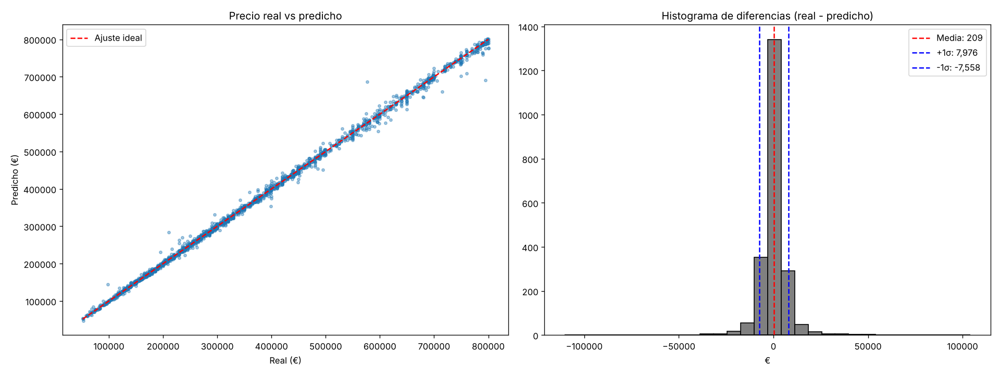

# Predicción de precios de vivienda en Madrid

Trabajo Final del **Máster Universitario en Data Science for Finance** — EAE Business School (Madrid, 2024).
*"Implementación de un modelo de predicción de precios en el sector inmobiliario de Madrid"*.

Este repositorio es una **réplica funcional** del TFM: el código de los notebooks se ha reorganizado en un
pipeline reproducible (`src/`) y una aplicación web (`app/`) que permite usar el modelo con los datos originales
o con datos nuevos.



## Objetivo

Estimar el precio de venta de viviendas en Madrid a partir de las ofertas publicadas en **Idealista** para:

1. **Business Case 1 – Identificar ofertas infravaloradas:** inmuebles cuyo precio publicado está por debajo del valor estimado por el modelo.
2. **Business Case 2 – Tasar un inmueble:** estimar el valor de una vivienda a partir de sus características.

## Datos

| | |
|---|---|
| Fuente | API de Idealista v3.5 (`search`, operación *sale*, radio de 15 km desde Sol) |
| Periodo | Febrero – mayo 2024 (4 descargas mensuales, `data/raw/`) |
| Ofertas únicas | 14.993 (duplicados eliminados por `propertyCode`) |
| Alcance del modelo | Provincia de Madrid, precio ≤ 800.000 € → **10.766 ofertas, 143 barrios** |

## Metodología

```
data/raw/*.csv ──► merge_and_clean_data ──► procesamiento_datos ──► feature_engineering ──► modelos
                   (une meses, dedup)       (floor, exterior,        (€/m² medio por distrito
                                             hasLift, parking…)       y barrio, roomSize,
                                                                      bathroomSize…)
```

- **Preprocesado:** `StandardScaler` (numéricas) + `TargetEncoder` (categóricas) dentro de un `Pipeline`.
- **Partición:** 80 % entrenamiento / 20 % test (`random_state=42`).
- **Modelos comparados:** Linear Regression, Random Forest, Gradient Boosting y XGBoost sobre tres versiones del dataset.
- **Modelo final:** `GradientBoostingRegressor` optimizado con `RandomizedSearchCV` (n_iter=50, cv=5) usando las variables más importantes: `neighborhood`, `priceByArea`, `size`, `bathrooms`, `bathroomSize`.

## Resultados (reproducidos)

| Modelo final | R² | MAPE | RMSE | MAE |
|---|---|---|---|---|
| TFM original | 0.9985 | 1.30 % | 7.909 € | 4.276 € |
| Esta réplica | 0.9985 | 1.32 % | 7.768 € | 4.297 € |

Las pequeñas diferencias se deben a las versiones de las librerías. El benchmark completo (Tabla 6 del TFM)
se guarda en `reports/metrics.json` y se muestra en la pestaña **Modelo** de la app.

**Ejemplo Business Case 1:** la oferta `104475383` (Aluche, 196 m²) se publicó a 210.000 € y el modelo la valora en ~283.000 €.

## Aplicación

| Pestaña | Qué hace |
|---|---|
| **Tasador** | Elige distrito y barrio; el €/m² se rellena con la media del barrio (editable). Introduce m² y baños y obtén el precio estimado frente a las ofertas del barrio. |
| **Oportunidades** | Ranking de ofertas del test con mayor descuento frente al modelo, con filtros y descarga CSV. |
| **Cargar datos** | Sube un CSV (formato Idealista o formato simple) y obtén la valoración de cada inmueble. |
| **Mapa** | €/m² medio y número de ofertas por distrito. |
| **Modelo** | Métricas, real vs predicho, importancia de variables y benchmark. |
| **Datos** | Dataset procesado y tabla de referencia por barrio. |

## Cómo ejecutarlo

```bash
git clone https://github.com/<tu-usuario>/madrid-housing-price-prediction.git
cd madrid-housing-price-prediction
python -m venv .venv
.venv\Scripts\activate          # Windows  (Linux/Mac: source .venv/bin/activate)
pip install -r requirements.txt

python scripts/run_pipeline.py  # limpia datos, entrena y genera reports/ (~30 s)
streamlit run app/streamlit_app.py
```

Opciones del pipeline:

```bash
python scripts/run_pipeline.py --search          # repite la búsqueda de hiperparámetros (lento)
python scripts/run_pipeline.py --skip-benchmark  # solo el modelo final
pytest -q                                        # tests de regresión frente al TFM
```

### Descargar datos nuevos de Idealista

```bash
cp .env.example .env    # y rellena IDEALISTA_API_KEY / IDEALISTA_SECRET
python -m tfm.extract --pages 20 --out data/raw/idealista_nuevo.csv   # (desde src/ o con PYTHONPATH=src)
```

La API permite 100 peticiones al mes. Los CSV descargados pueden valorarse directamente desde la pestaña **Cargar datos**.

## Estructura

```
├── app/streamlit_app.py        # aplicación web
├── data/
│   ├── raw/                    # descargas de la API (feb-may 2024)
│   ├── processed/              # dataset final + referencia por barrio (generados)
│   └── geo/                    # distritos de Madrid (GeoJSON)
├── models/gbr_tfm.joblib       # modelo final entrenado
├── notebooks/original/         # notebooks originales del TFM
├── reports/                    # métricas, predicciones de test y figuras
├── scripts/run_pipeline.py     # pipeline de principio a fin
├── src/tfm/                    # config, data, features, models, predict, extract
└── tests/                      # tests de regresión
```

## Limitaciones conocidas y siguientes pasos

Esta versión replica el TFM **tal como se entregó**. Para una siguiente versión se han identificado:

- **Fuga de información del target:** en los datos de Idealista `price = priceByArea × size`, y `priceByArea` es una variable de entrada. Esto explica el R² cercano a 1 y obliga a conocer el €/m² para tasar. Un modelo sin `priceByArea` (solo características físicas y ubicación) obtiene un R² ≈ 0.90 y un MAPE ≈ 13 %.
- Las medias de €/m² por distrito y barrio se calculan sobre todo el dataset (incluido el test).
- El filtro usa `province == 'Madrid'`, por lo que incluye ofertas de otros municipios (Pozuelo, Leganés…).
- Validación temporal (entrenar con feb-abr y validar con mayo) en lugar de una partición aleatoria.

## Autores

Grupo 1 — Nimrod Abraham Saigg · Nicolás Delgado Lorino · **Manuel Anthony Gonzales Aparco** · José Rodríguez Muñoz · Víctor Hugo Yáñez Villagómez

Tutor: Prof. D. Roberto Maestre Martínez

*Los datos proceden de la API de Idealista y se incluyen solo con fines académicos.*
